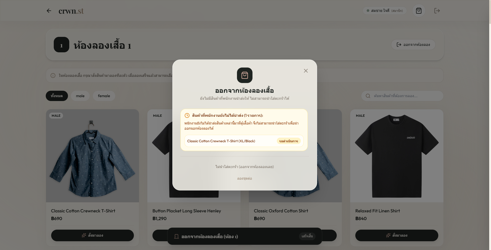
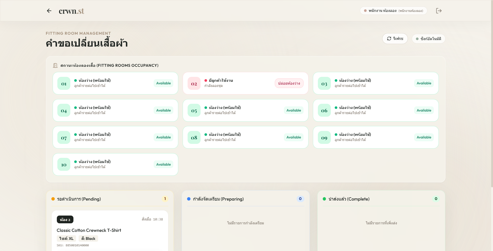
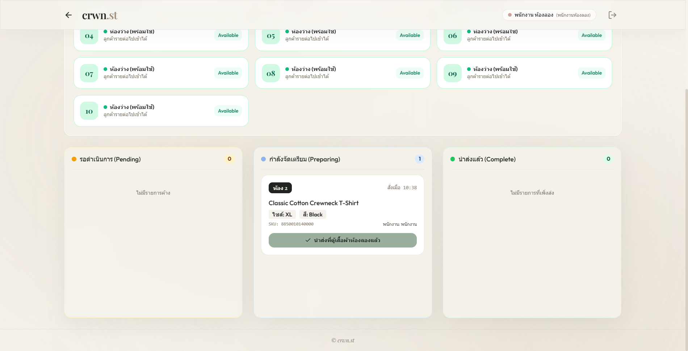
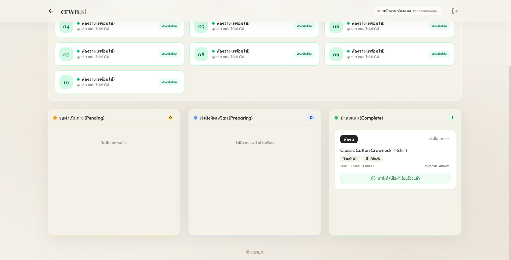
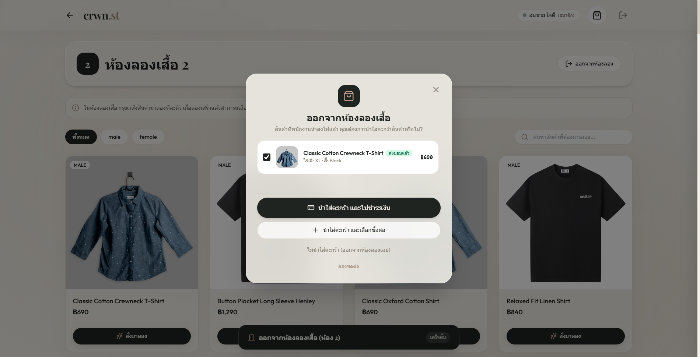

# crwn.st — Browser E2E Report (2026-10-15)

> **สถานะ:** รันจริงบนเบราว์เซอร์ Chrome 155 ผ่าน `browser-skill` (`bsk` 0.3.2) — ไม่ใช่ mock และไม่ใช่ curl
> **เป้าหมาย:** ยืนยันบั๊ก A (คำเตือนสินค้าค้างก่อนออก) และบั๊ก B (คำขอ session เก่าไม่กลับเข้า Kanban) บน UI จริง
> **DB:** `crwn_st_test` บน MySQL 8.0.46 ใน WSL (isolated) — **ไม่แตะฐานจริงของ KMITL**

## Setup

| อย่าง | ค่า |
| --- | --- |
| แอป | `node tests/run-isolated.js serve` → `http://localhost:3000` ชี้ `crwn_st_test` |
| bsk | daemon เป็น managed background task (`--foreground`, `BSK_AUTO_START=0`) · instance `ab6633a1` (chrome 155, label "Work") · session `ieak` |
| บัญชี | ลูกค้า `0812345678` (`u1`) และพนักงานห้องลอง `68070056` — ทั้งคู่เป็น **fixture ใน `database/seed.js`** |
| รหัสผ่าน | ผู้ใช้เป็นคนกรอกเองผ่าน `bsk request-help` (masked overlay) — agent ไม่พิมพ์และไม่รับรหัสในแชต |

## ผลการทดสอบ

### 1. บั๊ก A — คำเตือนก่อนออกจากห้อง เมื่อมีคำขอที่ยังไม่นำส่ง ✅

ลูกค้าเข้าห้อง 1 → สั่งสินค้า (`Classic Cotton Crewneck T-Shirt`, XL/Black) → สร้าง pending order `fo_053cce1d-…` → กด "ออกจากห้องลอง"

โมดัลขึ้น **"สินค้าที่พนักงานยังไม่ได้นำส่ง (1 รายการ):"** พร้อมรายการ `Classic Cotton Crewneck T-Shirt (XL/Black)` สถานะ **"รอดำเนินการ"** และปุ่ม `ไม่นำใส่ตะกร้า (ออกจากห้องลองเลย)` / `ลองชุดต่อ`

กด "ลองชุดต่อ" → DB ยืนยันว่า **ไม่** ปล่อยห้อง (`FITTING_ROOM_SLOT` ห้อง 1 ยังผูก session เดิม)

### 2. ยืนยันออกแล้ว policy ทำงานถูก ✅

กลับมากด "ออกจากห้องลอง" → "ไม่นำใส่ตะกร้า (ออกจากห้องลองเลย)" แล้วตรวจ DB ทันที:

| สิ่งที่ตรวจ | ค่า |
| --- | --- |
| `FITTING_ROOM_SLOT` ห้อง 1 | `NULL` (ปล่อยห้องแล้ว) |
| `FITTING_ROOM_SESSION` `FTR_EndReason` | `RELEASED` |
| order `fo_053cce1d-…` | `FTR_CancelledAt` ถูกตั้ง, `EMP_ID` ยัง `NULL` |

ตรงตาม policy: **ยกเลิกเฉพาะ pending ของ session ที่จบ** และเก็บแถวเป็นประวัติ

### 3. บั๊ก B — คำขอเก่าไม่กลับเข้า Kanban ✅

เข้าห้อง 1 อีกครั้ง (session ใหม่) → กดออกจากห้อง → **ไม่มีคำเตือนค้าง** และออกจากห้องได้ทันที (ไม่ใช่เส้นทาง no-orders ที่พาไปเจอคำขอเก่า)

สลับไปล็อกอินเป็นพนักงานห้องลอง → Kanban ทุกคอลัมน์เป็น 0 ("ไม่มีรายการค้าง", "ไม่มีรายการกำลังเตรียม", "ไม่มีรายการที่เพิ่งส่ง") และ `GET /api/fitting-orders` ใน session ของพนักงานคืน `{"count":0,"orders":[]}`

### 4. staff flow บน UI จริง — claim → complete ✅

seed session สดของห้อง 2 ลง DB แยกโดยตรง (เพื่อไม่ต้องล็อกอินลูกค้าซ้ำ) แล้วทดสอบผ่าน UI:

| ขั้น | UI | DB |
| --- | --- | --- |
| โหลด Kanban | Pending = 1 การ์ด "ห้อง 2 / สั่งเมื่อ 10:38 / XL / Black" | `EMP_ID` = NULL |
|  | | |
| กด "รับงานจัดเตรียม" | Pending = 0, Preparing = 1 พร้อม "พนักงาน: พนักงาน" | `EMP_ID` = `68070056` |
|  | | |
| กด "นำส่งที่ตู้เสื้อผ้าห้องลองแล้ว" | Complete = 1 การ์ดแสดง **"ส่งเมื่อ 10:39"** (ใช้ `finishedAt` ไม่ใช่ `createdAt`) | `FTR_FinishTime` = `10:39:23` |
|  | | |

ข้อสังเกตเชิงกลไก: การคลิกด้วย ref `@eN` ล้มเหลว 2 ครั้งด้วย `element not visible` หลังถ่ายสกรีนช็อต (ref ไม่ fresh) — แก้โดย `scrollIntoView` + คลิกด้วย CSS selector `#btn-order-<id>` ที่หน้าเว็บกำหนดไว้เอง คลิกด้วย ref ควร observe ใหม่ทุกครั้งหลัง DOM เปลี่ยน

### 5. ของที่นำส่งแล้วต้องไม่ขึ้นคำเตือน (เกณฑ์ A03) ✅

ลูกค้าเข้าห้อง 2 ที่มี order `complete` อยู่ → กดออกจากห้อง → โมดัลขึ้น **"สินค้าที่พนักงานนำส่งให้แล้ว คุณต้องการนำใส่ตะกร้าสินค้าหรือไม่?"** พร้อม badge **"ส่งมอบแล้ว"** ของ `(XL/Black)` ไม่มีกล่องคำเตือนสีเหลือง

กด "นำใส่ตะกร้า และเลือกซื้อต่อ" → กลับหน้า dashboard, ตะกร้ามี `8850010140000` (`PAY_CART_ITEM` = 1 แถว) และ DB:

| สิ่งที่ตรวจ | ค่า |
| --- | --- |
| `FITTING_ROOM_SLOT` ห้อง 2 | `NULL` |
| session | `FTR_EndReason` = `RELEASED` |
| order `fo_e2e_staff_0001` | `FTR_FinishTime` = `10:39:23` **คงอยู่**, `FTR_CancelledAt` = `NULL` |

ยืนยันว่า **complete ไม่ถูก cancel ตอน release** (อยู่เป็นประวัติ) ต่างจาก pending

## ข้อจำกัดของหลักฐานชุดนี้

- ทั้งหมดรันบน **isolated DB** ไม่ใช่ฐานจริงของ KMITL — ยังไม่มี browser E2E กับ production
- ขั้นตอนฝั่งพนักงาน (ข้อ 4) seed session/คำขอลง DB โดยตรงแทนการเดินผ่าน UI ลูกค้า เพื่อเลี่ยงการล็อกอินซ้ำ; ส่วนฝั่งลูกค้า (ข้อ 1, 3, 5) เดินผ่าน UI จริงทั้งหมด
- ไม่ได้ทดสอบ concurrency ผ่าน UI (ครอบด้วย `tests/api.test.js` suite 7 แทน) และไม่ได้ทดสอบ checkout/ชำระเงินจริง
- พบข้อสังเกตทาง UX: คอลัมน์ "นำส่งแล้ว (Complete)" จะว่างทันทีที่ลูกค้าออกจากห้อง เพราะ feed ผูกกับ session ที่ยัง active — ตรงตาม policy ที่อนุมัติ แต่ถ้าธุรกิจต้องการเห็นงานที่เพิ่งส่งหลังลูกค้าออก ต้องออกแบบมุมมองประวัติแยก

## เอกสารเชื่อมโยง

- [[10-existing-change-review]] — สถานะ work review และผล mock/integration
- [[02-architecture-and-api-contract]] — policy lifecycle และ contract ที่ทดสอบชุดนี้
- `tests/ISOLATED-DB.md` — วิธีรัน isolated DB ที่ใช้ในชุดนี้
